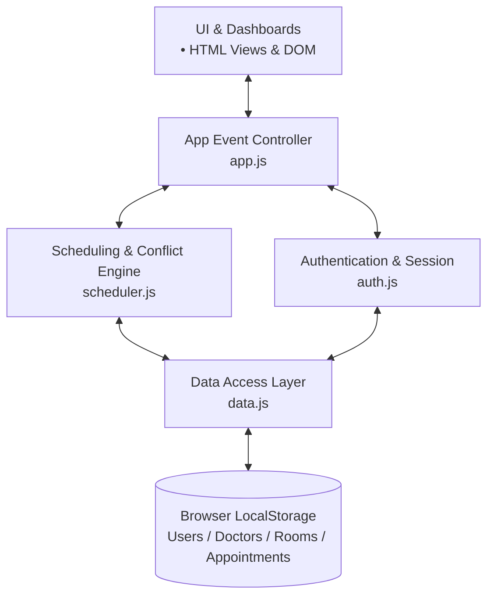

# 🏥 Multi-Doctor Appointment Conflict Scheduler

[](LICENSE)
[](https://developer.mozilla.org/en-US/docs/Web/HTML)
[](https://developer.mozilla.org/en-US/docs/Web/CSS)
[](https://developer.mozilla.org/en-US/docs/Web/JavaScript)
[](#data-management)

A robust, front-end scheduling engine designed to eliminate double-bookings, overlap errors, and facility resource bottlenecks in multi-doctor clinical environments.

---

##  Table of Contents
- [Overview](#-overview)
- [Problem Statement](#-problem-statement)
- [System Architecture](#-system-architecture)
- [Core Workflows & Logic](#-core-workflows--logic)
- [Key Features](#-key-features)
- [Project Structure](#-project-structure)
- [Installation & Setup](#-installation--setup)
- [Git & Branching Strategy](#-git--branching-strategy)
- [Future Roadmap](#-future-roadmap)

---

##  Overview

The **Multi-Doctor Appointment Conflict Scheduler** addresses the scheduling complexity of multi-provider clinics. By evaluating practitioner schedules, room allocations, operating hours, and existing time slots simultaneously, the system prevents double-booking and suggests alternative slots in real time.

---

##  Problem Statement

Manual and decentralized clinic scheduling often results in:
* **Doctor Double-Booking:** Overlapping patient appointments for the same provider.
* **Room Collisions:** Multiple practitioners assigned to the same examination room at the same time.
* **Friction in Rescheduling:** Time wasted searching for open slots across disjointed schedules.
* **Data Desynchronization:** Lack of unified tracking between patient requests and doctor rosters.

---

## Architecture

The Multi-Doctor Appointment Scheduler is built using a clean, decoupled client-side architecture separating UI Presentation, Event Coordination, Scheduling Logic, Authentication, and Local Storage Persistence:


---

## Core Workflows & Logic

### Appointment Scheduling & Conflict Engine

```text
1. Patient Requests Appointment
                ↓
2. Check Doctor Availability
                ↓
3. Check Room Availability
                ↓
4. Check Appointment Time Conflicts
                ↓
       ┌────────┴────────┐
       ↓                 ↓
   Conflict           No Conflict
       ↓                 ↓
Find Next Available   Confirm Booking
       ↓                 ↓
Present Alternative   Save Appointment
                         ↓
                    LocalStorage
```
### Appointment Conflict Detection

The scheduling engine prevents overlapping appointments by comparing the start and end times of the requested appointment with existing bookings.

**Conflict occurs when:**

> Requested Start < Existing End  
> **AND**  
> Requested End > Existing Start

If both conditions are satisfied, the appointment overlaps with an existing booking.

---

##  Key Features

###  Patient Portal
* **Authentication:** Secure registration, session-based login, and password recovery.
* **Smart Booking:** Real-time doctor selection, service matching, and slot validation.
* **Appointment Tracking:** Manage upcoming visits, view booking status, and submit feedback.

###  Doctor Dashboard
* **Schedule Monitor:** Real-time view of daily/weekly patient rosters.
* **Room Management:** Visibility into assigned examination rooms and operational slots.
* **Status Updates:** Update appointment statuses (Completed, Rescheduled, Cancelled).

###  Conflict Resolution Engine
* **Double-Booking Prevention:** Blocks simultaneous bookings for the same practitioner.
* **Room Contention Checks:** Validates physical room availability per time segment.
* **Alternative Slot Recommender:** Automatically calculates the nearest available opening when a collision occurs.

---
## Project Structure

```text
Multi-Doctor-Appointment-Scheduler/
│
├── index.html                  # Landing page
├── login.html                  # User login
├── signup.html                 # User registration
├── forgot-password.html        # Password recovery
├── book-appointment.html       # Appointment booking
├── appointments.html           # Appointment listing and management
├── patient-dashboard.html      # Patient dashboard
├── doctor-dashboard.html       # Doctor dashboard
├── profile.html                # User profile
├── reviews.html                # Reviews and ratings
│
├── css/
│   └── styles.css              # Application styling and responsive layout
│
├── js/
│   ├── app.js                  # General application functionality
│   ├── auth.js                 # Authentication and session handling
│   ├── data.js                 # Application data and LocalStorage operations
│   └── scheduler.js            # Scheduling and conflict detection logic
│
└── README.md                   # Project documentation
```

---

## Installation & Setup

### Prerequisites

Before running the project, make sure you have:

- A modern web browser such as Chrome, Firefox, Edge, or Safari
- Git
- Visual Studio Code
- Live Server extension for Visual Studio Code (recommended)

### Clone the Repository

```bash
git clone https://github.com/Prabhleen006/Multi-Doctor-Appointment-Scheduler.git
cd Multi-Doctor-Appointment-Scheduler
```

### Run the Project

#### Using VS Code Live Server

1. Open the project in Visual Studio Code.
2. Right-click `index.html`.
3. Select **Open with Live Server**.
4. The application will open in your default browser.

#### Direct Browser Access

You can also open `index.html` directly in a web browser. However, using Live Server is recommended for a smoother development experience.

---

## Git Branching Strategy

The project uses a feature-branch workflow to organize team contributions.

```text
main
│
├── feature/scheduler
│   └── Appointment booking and scheduling logic
│
├── AuthenticationAuthorization
│   └── Authentication and user access functionality
│
└── Dashboard
    └── Patient and doctor dashboard functionality
```

Each team member works on their assigned feature branch. Completed and tested changes are merged into the `main` branch for final integration.

---

## Future Enhancements

The current project is a frontend-based implementation using JavaScript and LocalStorage. Future versions can extend the system with:

- **Backend Integration:** Node.js and Express REST APIs
- **Database Integration:** MongoDB for persistent data storage
- **Secure Authentication:** JWT-based authentication and role-based access control
- **Real-Time Updates:** Live appointment and availability synchronization
- **Notifications:** Automated email or SMS appointment reminders
